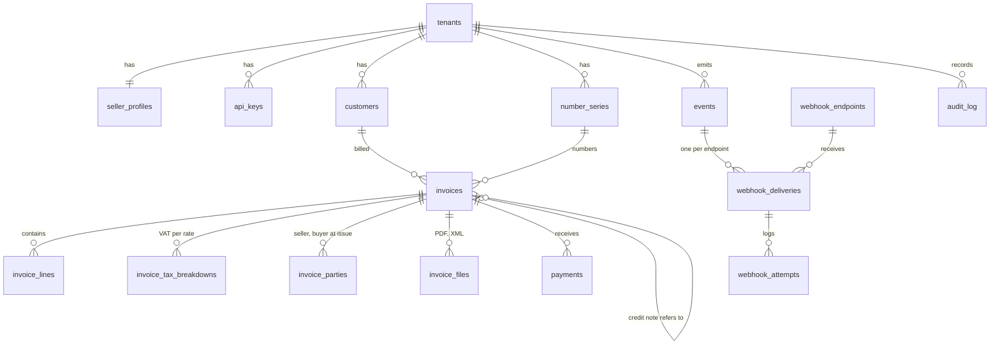
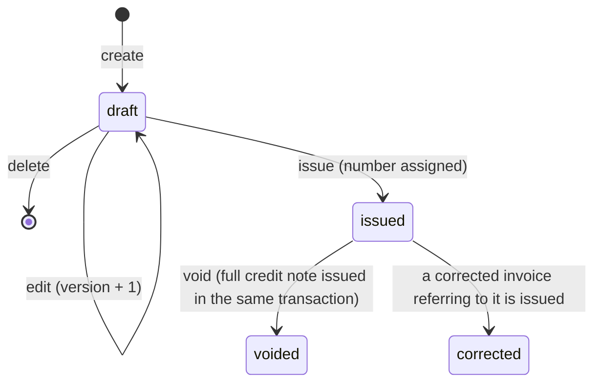

# Data model and first database schema (phase 1)

- **Status:** Accepted (ADR 0007). The SQL comes next, against the acceptance criteria below.
- **Date:** 2026-11-01
- **Sources:** the domain notes in [`docs/domain/`](../domain/README.md), ADR 0003 (queues), ADR 0005 (pgx, RLS per transaction).

This is a living design document, not an ADR. The significant choices in it get ADRs once the owner has decided them. It covers the phase 1 core flow: tenants and API keys, customers, the invoice lifecycle, numbering, tax calculation, payments, events and webhooks, the audit log, and files.

## Decisions for the owner

Each has a recommendation. The owner accepted the recommendation for all ten on 2026-11-01 (ADR 0007). D10 came out of the open question on Japanese corrections, after D1 to D9 were settled. The rest of this document follows these decisions.

| # | Question | Recommended | Alternative |
|---|---|---|---|
| D1 | How to store money | `numeric` everywhere, with a check that the scale fits the currency (EUR 2, JPY 0); a decimal library in Go | `bigint` minor units for amounts, but quantity and price still need decimals, so two representations |
| D2 | Where the tables live, and who connects | A dedicated schema `app`; the API connects as its own role `jade_api` without `BYPASSRLS` and without owning tables; RLS `FORCE`d on every table | Tables in `public`, connect as `postgres` (bypasses RLS, so isolation would rest on Go code alone) |
| D3 | How to model credit notes and corrections | One `invoices` table with a `document_type` | One table per document type |
| D4 | What "void" means | Voiding an issued invoice issues a full credit note and marks the original `voided`, in one transaction | A status flag only. Not recommended: the buyer and the tax records would see no document, while both countries correct issued invoices with a new document that refers to the original ([domain rule 1](../domain/README.md#rules-that-shape-the-design-most)) |
| D5 | How issued invoices keep the seller's and buyer's details | Copied at issue into `invoice_parties`, with one column per EN 16931 field | A `jsonb` snapshot (flexible, but the database cannot check required fields) |
| D6 | When the invoice number is assigned | At issue, from a counter row locked in the issue transaction (gapless, concurrency-safe) | A Postgres `sequence` (leaves gaps on rollback and is not per tenant) |
| D7 | Phase 1 scope cuts | See [Not in phase 1](#not-in-phase-1). Main ones: no allowances or charges, only standard-rated VAT, net prices only, one jurisdiction per tenant | Wider scope now |
| D8 | How webhook signing secrets are stored | Encrypted in Go with AES-256-GCM, key from the environment, key ID stored for rotation | Supabase Vault, or plaintext until phase 4 |
| D9 | How payments are recorded | A separate insert-only `payments` table; "paid" is derived, so the invoice row never changes for it | A `paid_at` column on the invoice (would need another exception to immutability) |
| D10 | How errors in an issued invoice are corrected | Offer corrected invoices in phase 1 for both countries. Issuing a `corrected_invoice`, which restates all items and refers to the original, moves the original from `issued` to `corrected` in the same transaction | Defer corrected invoices (then Japan has no compliant way to fix an error), or offer them for Japan only |

## Overview

`tax_rates` is a global reference table with no tenant.

## Conventions

- **Schema `app`.** Supabase's API roles (`anon`, `authenticated`) are set up around the `public` schema. A separate schema keeps the tables away from whatever defaults the project applies there, so nothing is exposed by accident even if the Data API is turned back on. A test checks that those roles have no access (acceptance criterion 9).
- **Keys:** `uuid` from `gen_random_uuid()`. Insert-only logs (`audit_log`, `webhook_attempts`) use `bigint generated always as identity`.
- **Tenant column on every tenant table**, including child tables (`invoice_lines` and the like), so every RLS policy is the same one-line check and needs no join.
- **Composite foreign keys** carry the tenant: for example `(tenant_id, customer_id) references customers (tenant_id, id)`. A reference to another tenant's row then fails in the database, even if a bug passes the wrong ID. Each parent table has `unique (tenant_id, id)` for this.
- **Times:** `timestamptz`. Business dates (issue date, supply date, due date) are `date`, taken in the tenant's time zone.
- **Money (D1):** `numeric(18,2)` for amounts, which caps them at two decimals. Tables with a `currency` column add `check (x = round(x, app.minor_units(currency)))`, where `app.minor_units` returns 2 for EUR and 0 for JPY; child tables (lines, breakdowns, payments) get the same check in the trigger that already reads the parent invoice. Quantity and unit price are `numeric(18,6)`, because EN 16931 limits neither (see [germany-en16931-calculation.md](../domain/germany-en16931-calculation.md#decimals)). Never a float, in SQL or Go.
- **Codes as `text` with `check` constraints**, not Postgres enums, because adding a value to a check is a plain migration and the values read the same in SQL, Go, and JSON.
- **Personal data** columns are marked *PII* below. In phase 1 they are plain text; phase 4 adds field-level encryption and the retention and erasure rules.
- `created_at` and `updated_at` on mutable tables, `created_at` only on insert-only tables.

## Roles and row-level security (D2)

| Role | Used by | Rights |
|---|---|---|
| `postgres` | Migrations (Supabase CLI) | Owns every object |
| `jade_api` | Go API and the queue worker | `LOGIN`, `NOBYPASSRLS`, owns nothing. Table rights listed per table below; no `TRUNCATE`, no DDL |

- Every table in `app` has RLS **enabled and forced**. Forced matters because a table owner otherwise bypasses its own policies.
- `app.current_tenant_id()` returns `nullif(current_setting('app.tenant_id', true), '')::uuid`. Each request sets it with `set_config('app.tenant_id', $1, true)` at the start of its transaction (ADR 0005).
- One policy per table: `using (tenant_id = app.current_tenant_id()) with check (tenant_id = app.current_tenant_id())`. On `tenants` the column is `id`.
- **Fail closed:** with no tenant set the function returns null, `tenant_id = null` is never true, and the query sees no rows.
- **API key lookup** happens before the tenant is known, so RLS would hide the key. `app.find_api_key(prefix text)` is a `security definer` function owned by `postgres`, with `set search_path = ''`, executable only by `jade_api`. It returns the key's ID, tenant, hash, and expiry and revocation times for that one prefix; Go compares the hash in constant time.
- The queue worker handles messages from many tenants. Each message carries its tenant ID, and the worker sets it per message, so the worker is under RLS like the API.
- `tax_rates` has a policy that lets everyone read and nobody write.

## Tables

Rights for `jade_api` are given as S(elect), I(nsert), U(pdate), D(elete).

### `tenants` (S, U)

A client company. Created by an admin script in phase 1; self-service signup comes with the dashboard.

| Column | Type | Notes |
|---|---|---|
| `id` | uuid PK | |
| `name` | text | Display name |
| `jurisdiction` | text | `DE` or `JP`. One per tenant (D7) |
| `currency` | text | `EUR` for DE, `JPY` for JP (check) |
| `timezone` | text | IANA name, e.g. `Europe/Berlin`, `Asia/Tokyo`. Decides the issue date |
| `jp_tax_rounding` | text null | `down`, `up`, or `half_up`; required when JP, null when DE. The issuer chooses [NTA-QA-57] |
| `fiscal_year_end_month` | smallint | 1 to 12. Needed for the Japanese retention clock |
| `status` | text | `active` or `suspended` |

### `seller_profiles` (S, I, U)

One row per tenant (`tenant_id` is the PK): the seller details printed on invoices. Editable at any time, because issued invoices keep their own copy in `invoice_parties`. Whether a profile is complete enough to issue is checked at issue time, not by constraints, so a tenant can fill it in step by step.

| Column | EN 16931 | Notes |
|---|---|---|
| `legal_name` | BT-27 | |
| `trading_name` | BT-28 | |
| `address_line1` to `address_line3` | BT-35, BT-36, BT-162 | |
| `city`, `post_code` | BT-37, BT-38 | Required for XRechnung [BR-DE-3, BR-DE-4] |
| `country_subdivision`, `country_code` | BT-39, BT-40 | ISO 3166-1 alpha-2 |
| `vat_id` | BT-31 | DE: this or `tax_number` is required at issue |
| `tax_number` | BT-32 | German Steuernummer |
| `jp_registration_number` | | `T` + 13 digits (check `^T[0-9]{13}$`); required at issue for JP |
| `contact_name`, `contact_phone`, `contact_email` | BT-41, BT-42, BT-43 | *PII*. Required for XRechnung [BR-DE-2, BR-DE-5 to BR-DE-7] |
| `iban`, `bic`, `account_name` | BT-84, BT-86, BT-85 | Payment instructions, required for XRechnung [BR-DE-1] |

### `api_keys` (S, I, U)

| Column | Notes |
|---|---|
| `id`, `tenant_id`, `name` | |
| `prefix` | text, unique across all tenants. The public part of the key, used for lookup |
| `secret_hash` | bytea, SHA-256 of the secret part (check: 32 bytes) |
| `expires_at`, `revoked_at`, `last_used_at` | timestamptz null |

Key format: `jade_sk_<prefix>_<secret>`, with a random prefix and a 256-bit random secret. The secret is shown once at creation. A fast hash is enough because the secret is high-entropy random data, not a password: no one can guess it by brute force, so a slow hash such as bcrypt would only add latency to every request. `last_used_at` is updated at most once a minute per key, so authentication does not write on every request.

### `customers` (S, I, U)

The tenant's customers (the buyers).

| Column | EN 16931 | Notes |
|---|---|---|
| `external_ref` | | The client's own ID; unique per tenant when set |
| `kind` | | `business` or `individual` |
| `name` | BT-44 | *PII* when `individual`. Required (Japan requires the recipient's name) |
| `trading_name` | BT-45 | |
| `address_line1` to `address_line3`, `city`, `post_code`, `country_subdivision`, `country_code` | BT-50 to BT-55, BT-163 | *PII* when `individual`. City and post code required for XRechnung [BR-DE-8, BR-DE-9] |
| `vat_id` | BT-48 | |
| `legal_registration_id` | BT-47 | |
| `established_in_de` | | bool null. With `kind`, decides whether an E-Rechnung is required (from phase 2) |
| `default_buyer_reference` | BT-10 | Falls back to `-` [BMF-FAQ Q6] |
| `contact_name`, `contact_phone`, `contact_email` | BT-56 to BT-58 | *PII* |
| `email` | | Delivery address for invoices. *PII* |

No hard delete through the API: a customer referenced by an issued invoice must stay. Erasure (phase 4) will blank the personal fields of this row; the invoices keep their own copies under the retention rules.

### `number_series` (S, I, U)

| Column | Notes |
|---|---|
| `code` | Unique per tenant, e.g. `default`, `credit` |
| `prefix` | e.g. `INV-2026-` |
| `padding` | smallint, digits to pad the counter to |
| `next_value` | bigint, starts at 1 |

Each tenant gets a `default` series when it is created. Numbering is described [below](#invoice-numbering-d6).

### `tax_rates` (S; global, written only by migrations)

| Column | Notes |
|---|---|
| `jurisdiction`, `tax_category`, `rate` | e.g. `DE`, `S`, `19.00` |
| `valid_from`, `valid_to` | date; `valid_to` null while current |

Seeded with DE 19 and 7 [UStG-12] and JP 10 and 8 [NTA-EN]. A line's rate must be valid on the supply date, so a rate change becomes new rows, not new code.

### `invoices` (S, I, U, D: drafts only)

Invoices, credit notes, and corrected invoices (D3).

| Column | EN 16931 | Notes |
|---|---|---|
| `document_type` | BT-3 | `invoice` (380), `credit_note` (381), `corrected_invoice` (384). Japanese names for the PDF: 適格請求書, 適格返還請求書, 修正した適格請求書 |
| `status` | | `draft`, `issued`, `voided`, `corrected` |
| `customer_id`, `series_id` | | Composite FKs with `tenant_id` |
| `preceding_invoice_id` | BG-3 | Required for `credit_note` and `corrected_invoice`. Composite FK |
| `sequence_value`, `number` | BT-1 | Null while draft. `unique (tenant_id, number)`, `unique (series_id, sequence_value)` |
| `jurisdiction`, `currency` | BT-5 | Copied from the tenant at creation |
| `issue_date` | BT-2 | Set at issue, in the tenant's time zone |
| `supply_date` | BT-72 | Or the period below. Japan's 取引年月日 |
| `supply_period_start`, `supply_period_end` | BT-73, BT-74 | For monthly collective invoices [BMF-FAQ Q7b] |
| `due_date` | BT-9 | |
| `buyer_reference` | BT-10 | |
| `order_reference` | BT-13 | |
| `note` | BT-22 | |
| `payment_terms` | BT-20 | |
| `tax_rounding` | | The rounding rule used, recorded at issue: `half_away_from_zero` for DE, the tenant's mode for JP |
| `line_net_total` | BT-106 | |
| `allowance_total`, `charge_total` | BT-107, BT-108 | Always 0 in phase 1 (D7) |
| `tax_exclusive_total` | BT-109 | |
| `tax_total` | BT-110 | |
| `tax_inclusive_total` | BT-112 | |
| `prepaid_amount` | BT-113 | Advance payments deducted at issue. Later payments go to `payments` |
| `rounding_amount` | BT-114 | |
| `amount_due` | BT-115 | |
| `version` | | int, for optimistic locking of draft edits (the API's `If-Match`, step 3) |
| `retention_until` | | date, set at issue (see [Retention](#retention)) |
| `issued_at`, `voided_at`, `void_reason`, `corrected_at` | | |

Check constraints:

- `draft` ⇔ `number`, `sequence_value`, `issue_date`, `issued_at`, and `retention_until` are all null; otherwise all are set.
- `voided` ⇔ `voided_at` is set; `corrected` ⇔ `corrected_at` is set. Only `invoice` and `corrected_invoice` can be voided or corrected.
- At most one issued correction per original: a partial unique index on `preceding_invoice_id` where `document_type = 'corrected_invoice'` and `status <> 'draft'`.
- `credit_note` and `corrected_invoice` have `preceding_invoice_id`; `invoice` does not.
- Unless draft: `supply_date` or `supply_period_start` is set.
- The BR-CO formulas hold on the row: `tax_exclusive_total = line_net_total − allowance_total + charge_total`, `tax_inclusive_total = tax_exclusive_total + tax_total`, `amount_due = tax_inclusive_total − prepaid_amount + rounding_amount`.
- Every amount fits the currency's minor units.

The totals are kept up to date on every draft change, so a draft shows its current totals.

### `invoice_lines` (S, I, U, D: while the invoice is a draft)

| Column | EN 16931 | Notes |
|---|---|---|
| `invoice_id`, `position` | BT-126 | `unique (invoice_id, position)` |
| `name` | BT-153 | |
| `description` | BT-154 | |
| `quantity` | BT-129 | `> 0` in phase 1 |
| `unit_code` | BT-130 | UN/ECE Recommendation 20, default `C62` ("one") |
| `unit_price` | BT-146 | Net price, `>= 0` |
| `price_base_quantity` | BT-149 | Default 1, `> 0` |
| `tax_category` | BT-151 | `S` only in phase 1 (D7) |
| `tax_rate` | BT-152 | |
| `line_net_amount` | BT-131 | Calculated (see [Tax calculation](#tax-calculation)) |
| `period_start`, `period_end` | BT-134, BT-135 | Optional line period |

At most 500 lines per invoice, so a request stays well under Vercel's 4.5 MB body limit (ADR 0001).

### `invoice_tax_breakdowns` (S, I, U, D: while draft)

One row per VAT category and rate: EN 16931 BG-23, and Japan's per-rate totals and tax.

| Column | EN 16931 |
|---|---|
| `invoice_id`, `tax_category`, `tax_rate` (PK) | BT-118, BT-119 |
| `taxable_amount` | BT-116 |
| `tax_amount` | BT-117 |

### `invoice_parties` (S, I: written once, at issue)

Two rows per issued invoice (D5): `role` = `seller` or `buyer`, PK `(invoice_id, role)`. The columns are the union of the seller and customer address, identifier, and contact columns above. They are copied from `seller_profiles` and `customers` in the issue transaction, so later edits to those tables never change an issued invoice. *PII* as in the source tables.

### `invoice_files` (S, I)

| Column | Notes |
|---|---|
| `invoice_id`, `kind` | `pdf` in phase 1; `xrechnung`, `zugferd`, `validation_report` in phase 2. `unique (invoice_id, kind)` |
| `storage_path` | Path in a private Supabase Storage bucket |
| `content_type`, `byte_size` | |
| `sha256` | bytea. The archived file is never regenerated; the hash proves it is unchanged |

How and when the PDF is rendered is decided with the Typst spike (ADR 0006).

### `payments` (S, I)

| Column | Notes |
|---|---|
| `invoice_id` | Must be `issued`, not draft, voided, or corrected |
| `amount` | `> 0`, fits the currency |
| `paid_on` | date |
| `method`, `external_ref` | text, optional |

The invoice is paid when the sum of its payments reaches `amount_due` (D9). Recording a payment locks the invoice row first, so two concurrent payments cannot both miss the moment it becomes paid and the `invoice.paid` event is emitted once. Refunds and corrections of payments are not in phase 1.

### `idempotency_keys` (S, I, U, D)

| Column | Notes |
|---|---|
| `tenant_id`, `key` (PK) | The client's `Idempotency-Key` header |
| `method`, `path`, `request_hash` | A replay with a different request is rejected |
| `state` | `in_progress` or `completed` |
| `response_status`, `response_body` | Replayed on a repeat |
| `expires_at` | |

The exact semantics (lifetime, concurrent repeats, which endpoints) are part of the OpenAPI spec (step 3).

### `events` (S, I)

The record of what happened, and the transactional outbox for webhooks.

| Column | Notes |
|---|---|
| `id` | uuid. Sent to the client as the event ID, for its own deduplication |
| `type` | `invoice.issued`, `invoice.voided`, `invoice.corrected`, `invoice.paid`, `credit_note.issued` |
| `subject_type`, `subject_id` | |
| `payload` | jsonb, the body sent to webhooks |

### `webhook_endpoints` (S, I, U)

| Column | Notes |
|---|---|
| `url` | `https://` only (check) |
| `secret_ciphertext`, `secret_key_id` | D8 |
| `event_types` | text[]; empty means all |
| `enabled` | bool |

### `webhook_deliveries` (S, I, U)

| Column | Notes |
|---|---|
| `event_id`, `endpoint_id` | `unique (event_id, endpoint_id)`: one delivery per endpoint, however often the fan-out runs |
| `status` | `pending`, `succeeded`, `dead` |
| `attempt_count`, `next_attempt_at`, `last_attempt_at`, `last_response_status`, `last_error`, `succeeded_at` | |

### `webhook_attempts` (S, I)

| Column | Notes |
|---|---|
| `delivery_id`, `attempt_no` | `unique (delivery_id, attempt_no)` |
| `started_at`, `duration_ms`, `response_status`, `error` | `error` is truncated and never holds the request body |

The signature scheme, retry schedule, and payload format are part of step 3.

### `audit_log` (S, I)

| Column | Notes |
|---|---|
| `id` | bigint identity |
| `occurred_at` | |
| `actor_type`, `actor_id` | `api_key`, `user` (phase 3), or `system` |
| `action` | e.g. `invoice.issue`, `api_key.revoke` |
| `subject_type`, `subject_id` | |
| `request_id` | Links to the API logs |
| `details` | jsonb. **No personal data**, so an erasure never has to edit the audit log |

Written in the same transaction as the change it records. Phase 1 actions: API key create and revoke, invoice create, issue, void, and correct, credit note issue, payment record, webhook endpoint changes. Reads are not audited in phase 1.

## Invoice lifecycle

- **Drafts** have no number and no legal effect. They can be edited or deleted.
- **Issue** checks completeness (seller profile, customer, supply date, at least one line, valid rates), assigns the number, computes and stores the totals and breakdown, copies the parties, and sets `retention_until`. A credit note is issued the same way and gets its number from the series the tenant chooses.
- **Void (D4)** creates and issues a credit note for the full amount that refers to the original, then sets the original to `voided`, all in one transaction. A partial credit note leaves the original `issued`.
- **Correct (D10)** starts as a draft of type `corrected_invoice` with `preceding_invoice_id` set, edited like any draft, and restating all items. Issuing it locks the original, checks that it is still `issued`, gives the correction its own number, and sets the original to `corrected`, all in one transaction. A corrected invoice can itself be voided or corrected again.
- **Rules checked in Go at issue:** a credit note may only refer to an `issued` invoice or corrected invoice (not a credit note, a draft, or a voided or corrected document), and all credit notes for one invoice together may not exceed its `tax_inclusive_total`. In phase 1 an invoice that already has payments or credit notes cannot be corrected, because carrying them over to the correction is not designed yet.
- **Japan:** the PDF titles a credit note 適格返還請求書 (return invoice), which is for returns, discounts, and rebates. An error is fixed with a corrected invoice (修正した適格請求書) that either restates all items or states the corrected items, and in both cases shows its link to the original [NTA-QA-FULL 問33]. A plain new invoice after a void is not one of those methods ([japan-qualified-invoice.md](../domain/japan-qualified-invoice.md#other-documents-the-issuer-must-handle)). D10 implements the first method: restate all items and refer to the original.
- **Germany:** the same corrected invoice (384) works there too: the BMF accepts any practical correction method with a suitable invoice type while the codes are unsettled [BMF-2026 Rn. 20, 21], and XRechnung expects a 384 to reference the preceding invoice [BR-DE-26].

## Immutability, enforced in the database

Triggers, so the rule holds even if the Go code has a bug:

- **`invoices`, before update:** a draft may change freely, except that it may only move to `draft` or `issued`. An issued invoice may only move to `voided` or `corrected`, and only `status`, `voided_at`, `void_reason`, `corrected_at`, and `updated_at` may change; the trigger compares `to_jsonb(new)` and `to_jsonb(old)` without those keys. A voided or corrected invoice cannot change.
- **`invoices`, before delete:** only drafts.
- **`invoice_lines`, `invoice_tax_breakdowns`, `invoice_parties`, before insert, update, and delete:** the parent invoice must be a draft. The trigger reads the parent with `for share`, so it waits for a concurrent issue to commit and then sees the new status. When the parent is gone (a draft deleted with its lines by cascade), the change is allowed.
- **`payments`:** before insert, the invoice must be `issued`.
- The same parent-reading triggers check that child amounts fit the invoice's currency (no yen decimals), since a `check` constraint cannot read another table.
- **Insert-only tables** (`invoice_files`, `payments`, `events`, `webhook_attempts`, `audit_log`): `jade_api` has no `UPDATE` or `DELETE` grant, and a trigger rejects both for any role.

## Invoice numbering (D6)

The issue transaction, in order:

1. `select ... from app.invoices where id = $1 for update`: lock the draft and check its `version`.
2. `update app.number_series set next_value = next_value + 1 where id = $2 returning next_value - 1`: take the next number. The row stays locked until commit, so concurrent issues on the same series queue up here.
3. Compute and write the totals and breakdown, copy the parties.
4. Update the invoice to `issued` with the number.
5. Insert the event, the webhook deliveries, the `pgmq` messages, and the audit entry.
6. Commit.

If anything fails, the transaction rolls back, including the counter, so **numbers have no gaps and no duplicates**. Issues on one series are serialized for the few milliseconds of the transaction, which is far beyond what the free tier will ever carry.

**Lock order:** always the invoice rows first (in ID order when there are several, as in void and correct), then the number series. Every path that takes both locks follows this order, so they cannot deadlock each other.

## Tax calculation

From [germany-en16931-calculation.md](../domain/germany-en16931-calculation.md) and [japan-qualified-invoice.md](../domain/japan-qualified-invoice.md). A pure Go function, the same for both countries, with the rounding as a parameter:

1. Each line: `line_net_amount = round(quantity × unit_price / price_base_quantity)` to the currency's minor unit, half away from zero (the platform's choice; no rule found in either country).
2. Group lines by `(tax_category, tax_rate)`. `taxable_amount` = sum of the group's line net amounts.
3. `tax_amount = round(taxable_amount × rate / 100)` **once per group**: half away from zero to the cent for DE [BMF-2026 Rn. 17], [BR-CO-17]; the tenant's mode to the yen for JP [NTA-QA-57].
4. Totals by the BR-CO formulas (BT-106 to BT-115).

Tests assert exact amounts, including exact half cents and half yen, several rates on one invoice, and that per-line rounding would give a different result in the chosen cases. The KoSIT validator tolerates a tax amount off by up to one whole unit, so it cannot be relied on for this ([details](../domain/germany-en16931-calculation.md#validator-tolerance-versus-the-tax-rule)).

## Events and webhooks

- **Transactional outbox:** the event row, one delivery row per subscribed endpoint, and one `pgmq.send` per delivery are written in the same transaction as the change. `pgmq` lives in the same database, so a committed invoice always has its event and queued deliveries, and a rolled-back one has neither.
- **Messages carry only IDs** (`delivery_id`, `tenant_id`). The `pgmq` queue tables have no RLS, so they hold nothing a tenant should not see.
- **Worker** (ADR 0003): read a batch, set the tenant per message, lock the delivery row, send, record the attempt, then archive the message on success or push its visibility timeout out for the next retry. After the last attempt the delivery becomes `dead`.
- **At-least-once:** a crash after sending but before archiving sends again. The receiver deduplicates on the event ID; the signature and retry schedule are specified in step 3.

## Retention

`retention_until` is set at issue, from the jurisdiction's rule:

- **DE:** 8 years from the end of the calendar year of issue, so 31 Dec of the issue year + 8. [UStG-14b]
- **JP:** 7 years counted from the day after two months have passed since the end of the taxable period of issue, using the tenant's `fiscal_year_end_month`. [NTA-LEAFLET p.11]

Nothing is deleted when the date passes. Phase 4 lists expired documents for the tenant to confirm, because German periods can be extended while a tax assessment is open (see [retention-and-gdpr.md](../domain/retention-and-gdpr.md)).

## Indexes beyond keys and unique constraints

- `invoices (tenant_id, status, created_at desc)` and `invoices (tenant_id, customer_id, created_at desc)` for list endpoints.
- `invoices (tenant_id, preceding_invoice_id)` where not null, for the credit-note checks.
- `webhook_deliveries (tenant_id, status, next_attempt_at)`.
- `audit_log (tenant_id, occurred_at desc)` and `(tenant_id, subject_type, subject_id)`.
- `payments (tenant_id, invoice_id)`.

## Acceptance criteria for the migration

When the SQL is written, each of these has a test against a real Postgres (the local Supabase stack), run as `jade_api`:

1. With tenant A set, no table returns or accepts tenant B's rows. With no tenant set, every tenant table returns no rows.
2. A foreign key to another tenant's customer, series, or invoice is rejected.
3. On an issued invoice, updating any content column, deleting it, and inserting, updating, or deleting its lines, breakdowns, or parties all fail. `issued → voided` and `issued → corrected` work once; `draft → voided`, `draft → corrected`, and any change to a voided or corrected invoice fail. A second issued correction of the same original is rejected.
4. 50 concurrent issues on one series produce exactly the numbers 1 to 50; an issue that rolls back leaves no gap.
5. Totals that break a BR-CO formula, and a JPY amount with decimals, are rejected.
6. `UPDATE` and `DELETE` on insert-only tables fail.
7. `app.find_api_key` works with no tenant set and is the only way `jade_api` can read another tenant's row; it returns a key's revocation and expiry so Go can reject it.
8. A payment on a draft, voided, or corrected invoice is rejected.
9. `anon` and `authenticated` have no privileges on schema `app` or anything in it.

## Not in phase 1

Listed so the schema does not block them:

- Allowances and charges at line and document level (BG-20, BG-21, BG-27, BG-28). The total columns exist and stay 0.
- VAT categories other than `S` (zero-rated, exempt, reverse charge), which need exemption reasons (BT-120, BT-121).
- Negative quantities or prices.
- Gross (tax-inclusive) prices, in either country.
- Japan's simplified qualified invoice; corrections that state only the changed items (the NTA's second method); correcting a credit note; correcting an invoice that already has payments or credit notes.
- Advance, partial, and final invoices.
- Small businesses (Kleinunternehmer) and the German €800,000 turnover setting.
- More than one jurisdiction or currency per tenant.
- An event feed for polling. Clients poll each invoice's status in phase 1. A feed with a cursor needs care, because a row with a lower ID can commit after a higher one has been read.
- Dashboard users and roles (phase 3), quotas (phase 3), field-level encryption and erasure (phase 4).
- Partitioning `audit_log` and `webhook_attempts`, and a hash chain over the audit log.

## To verify when the schema is built

- That a custom login role such as `jade_api` can connect through the Supabase transaction pooler, and how its user name is written.
- Which grants a non-owner role needs to use `pgmq` (`send`, `read`, `archive`, `set_vt`).
- That the chosen Go decimal library rounds half away from zero, with a test.
- How the API writes to Supabase Storage without spreading the service-role key.
- What default privileges the Supabase project applies to new schemas (criterion 9).

## Sources

- **[BMF-2026]**, **[BMF-FAQ]**, **[UStG-12]**, **[UStG-14b]**: see [germany-e-invoicing.md](../domain/germany-e-invoicing.md#sources).
- **[BR-…]** rules: see [germany-en16931-calculation.md](../domain/germany-en16931-calculation.md#sources).
- **[NTA-EN]**, **[NTA-LEAFLET]**, **[NTA-QA-57]**, **[NTA-QA-FULL]**: see [japan-qualified-invoice.md](../domain/japan-qualified-invoice.md#sources).
